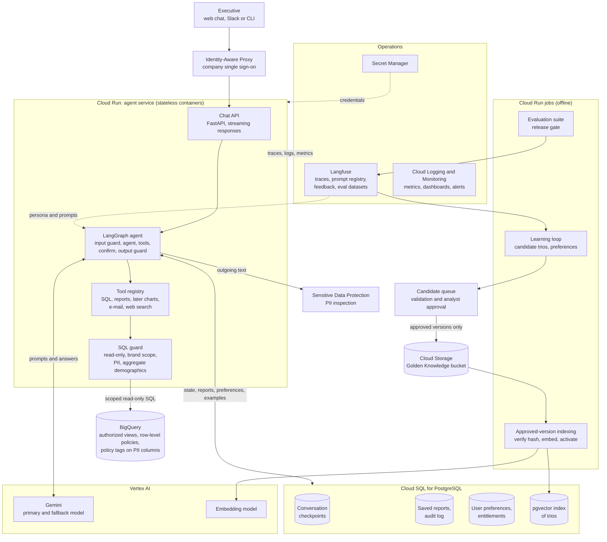
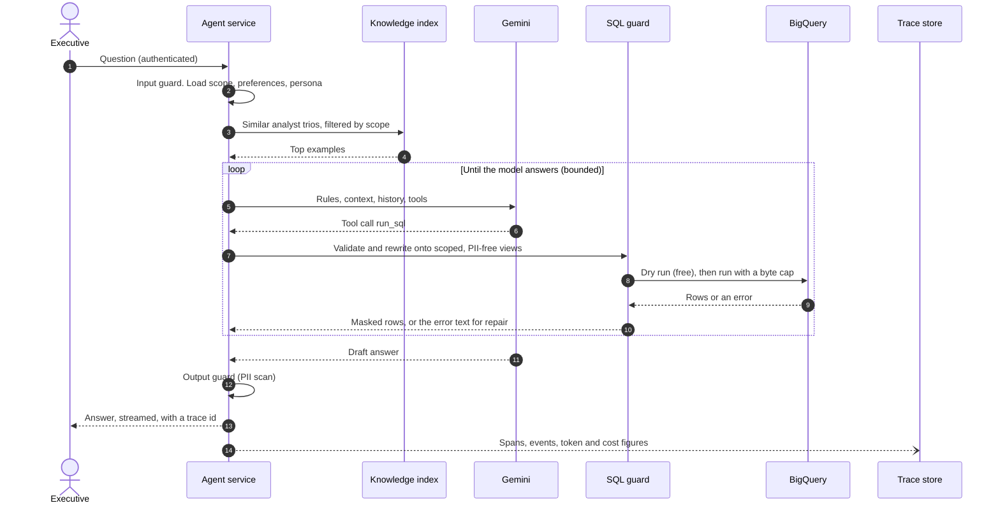
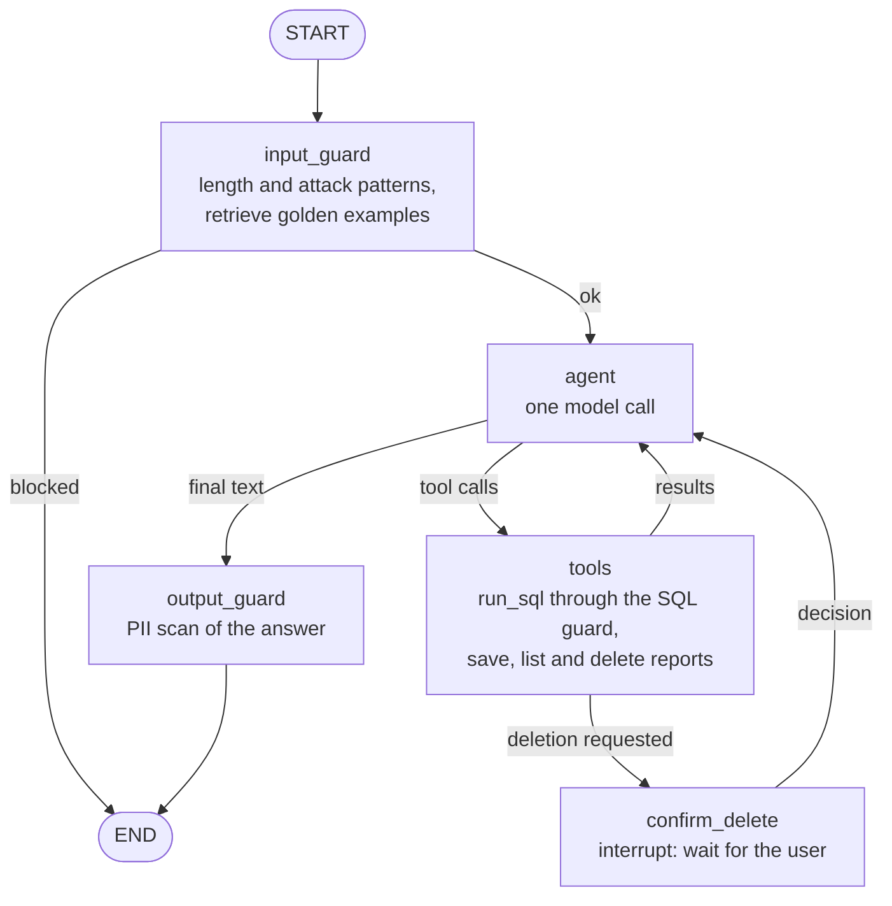
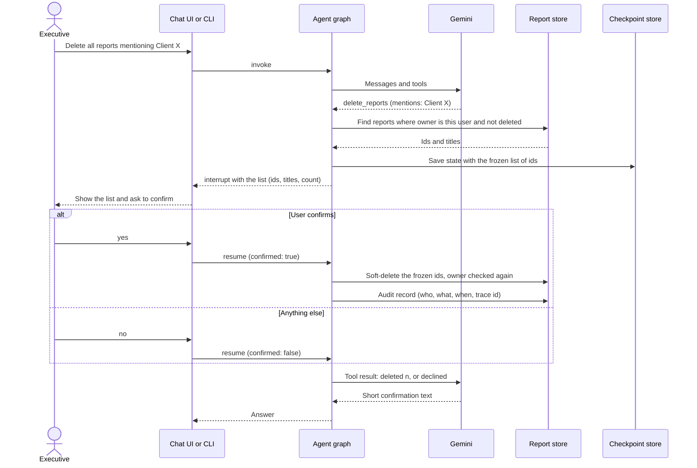
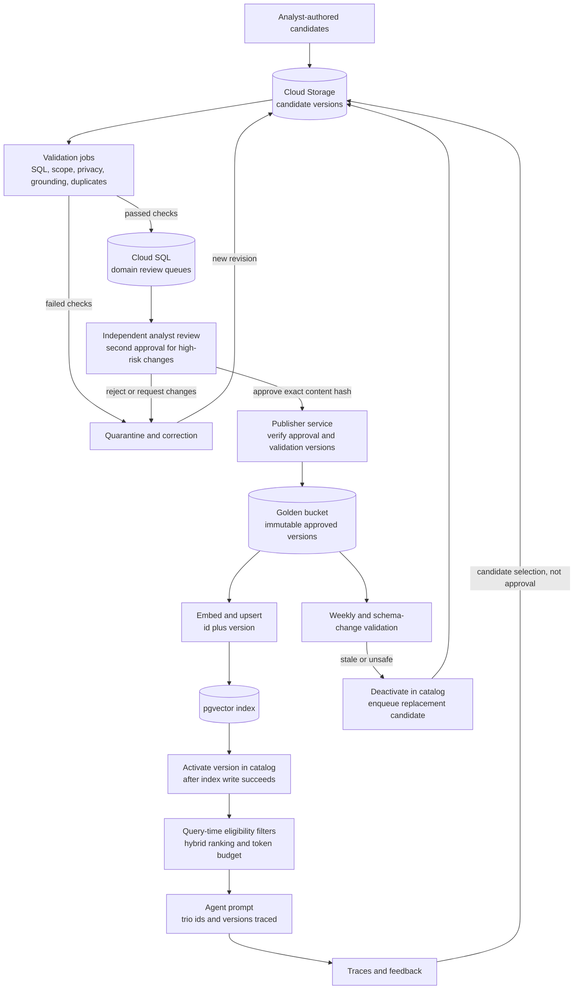
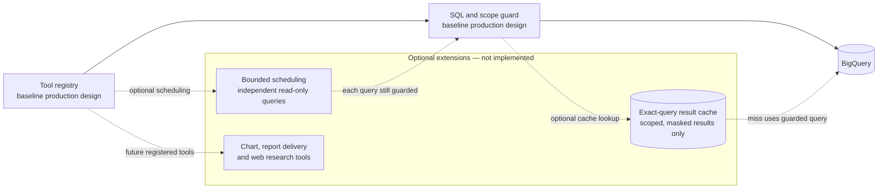

# Architecture (High-Level Design)

This document describes the production system. The prototype in this repository implements the agent core of it; section 11 maps each prototype part to its production counterpart. Section 12 separates optional future optimizations from that baseline. Reasons for the choices and the treatment of each requirement are in [TECHNICAL_EXPLANATION.md](TECHNICAL_EXPLANATION.md).

## 1. Context and assumptions

- Users are a small number of non-technical executives (tens, not thousands). They ask a few questions a day, and each question may take several queries. Correctness and safety matter more than throughput.
- The data warehouse is BigQuery and is read-only for the agent. The only state the agent may change is the Saved Reports library.
- The design uses Gemini and managed Google Cloud services, with application state in a dedicated project; the prototype queries Google's public dataset.
- Access is by brand only. Each manager has one or more authorized brands; only the CEO has all-brand access. Scoped managers cannot access company-wide totals or growth benchmarks. The dataset has no ownership mapping; the prototype assigns exact dataset brand names in `config/users.yaml`, while production uses an entitlement table. Brand values are used directly for access checks, model queries and results.
- Internal customer IDs and spend are allowed within the authorized brands. Age, gender, location and other demographics must not be attached to individual IDs; demographic analysis is aggregate-only.
- Revenue excludes cancelled/returned items. Churn defaults to 90 days without a purchase; answers state the definition and honor a user-specified inactivity window.

## 2. System diagram

This is the target production architecture, not a diagram of deployed prototype services. Embeddings and pgvector are already part of that target; optional caching and parallel query execution are shown separately in section 12.

## 3. Building blocks

| Block | Service | Responsibility | Why this choice |
|---|---|---|---|
| Entry and identity | Identity-Aware Proxy in front of Cloud Run | Authenticates the executive with company SSO and passes a verified identity to the service | No custom login code; the identity is what every later access check is based on |
| Agent service | Cloud Run (container: FastAPI + LangGraph) | Runs one conversation turn per request, streams the answer | Stateless and scales to zero; a turn is I/O bound, so no GPU or cluster is needed |
| Orchestration | LangGraph | The agent as an explicit state machine with checkpoints | Bounded loops, pause-and-resume for confirmations, and one place to attach tracing |
| Language model | Gemini on Vertex AI, with a lighter fallback model | Plans, writes SQL, interprets results, writes reports | Vertex AI provides enterprise quotas, regional control and no training on customer data |
| Data warehouse | BigQuery | Source of all figures | Given. Access control is enforced here as well as in the agent |
| Application state | Cloud SQL for PostgreSQL | Conversation checkpoints, saved reports, audit log, user preferences, entitlements, vector index | One transactional store: a deletion and its audit record commit together; LangGraph has a maintained Postgres checkpointer; pgvector avoids a separate vector service at this scale |
| Golden Knowledge | Cloud Storage (versioned bucket) plus a pgvector index | Trios as files are the source of truth; the index serves retrieval | Analysts submit candidates without application changes; approved versions are published after review, and the index can be rebuilt |
| Prompt and persona registry | Langfuse prompt management | Versioned persona text edited in a web UI, fetched at run time | Non-developers change tone without a deployment; versions, labels and rollback come for free |
| Tracing and evaluation | Langfuse (self-hosted in the deployment project) | One trace per turn, user feedback, evaluation datasets | Traces contain business questions and SQL, so they should stay in the deployment project; the same tool holds prompts and eval sets |
| Metrics and alerts | Cloud Logging and Cloud Monitoring (OpenTelemetry export) | Service metrics, dashboards, paging | Standard on Google Cloud; no extra system to operate |
| PII inspection | Sensitive Data Protection | Second check of outgoing text for personal data | Stronger than patterns alone for names and addresses |
| Secrets | Secret Manager | API keys and database credentials | No secrets in images or environment files |
| Offline jobs | Cloud Run jobs, triggered by Cloud Scheduler and bucket events | Trio ingestion, learning loop, evaluation runs | Same container image and code as the service |

Firestore and BigQuery vector search were considered for application state and for the trio index. One Postgres instance was preferred because it keeps reports, audit records and checkpoints transactional, supports indexed similarity search alongside transactional state, and is one service fewer to operate. At much larger scale the index can move to Vertex AI Vector Search without changing the retrieval interface.

## 4. Where data lives

| Data | Store | Contains personal data? | Notes |
|---|---|---|---|
| Transactions, customers, products | BigQuery | Yes (`users`) | The agent's identities can read only views without PII columns; policy tags block the rest |
| Conversation history and agent state | Postgres (checkpoints) | No query rows with PII; text is scanned before it is stored | Retention policy, for example 90 days |
| Saved reports | Postgres (`reports`, soft delete) | No (scanned on save) | Every row has `owner_id` and `thread_id`; deleted rows are purged after an undo window |
| Audit log | Postgres (`audit`) | No | Who deleted or restored what, when, with which trace id |
| User preferences | Postgres (`preferences`) | Preference values only | Viewable and resettable by the user |
| Entitlements | Postgres (`entitlements`) or the identity provider's groups | No | User to product scope |
| Golden trios | Cloud Storage, indexed in pgvector | No (scrubbed at ingestion) | Each trio is tagged with the product scope it concerns |
| Prompts and persona | Langfuse | No | Versioned |
| Traces | Langfuse | Questions and SQL; never result rows | Access limited to the support and engineering group |

## 5. A question, end to end

Notes on the flow:

1. The service is stateless. The conversation is loaded from the checkpoint store by conversation id at the start of the turn and saved after every step, so any instance can serve the next request and a crashed turn can be resumed.
2. The model never talks to BigQuery. It proposes SQL; code decides what actually runs.
3. Tracing is written asynchronously. A failure of the trace store never fails a user request.

## 6. The agent graph

The loop between `agent` and `tools` is bounded twice: a per-turn limit on model calls (the last allowed call is made with tools disabled, so the model must answer with what it has) and a per-turn limit on failed queries.

## 7. Deleting reports

The model can only request a deletion. The list is resolved by code, the decision is taken by the person in the UI, and the deletion acts on the list that was shown.

## 8. Golden Knowledge life cycle

**Design scope.** The bucket is a theoretical production component; no real bucket or expert examples were supplied. The nine local trios are explicitly labelled **sample data**. Their optional retrieval demonstrates the interface, while the production update, approval and retrieval system below is design-only.

### Format and ownership

A trio contains `question`, `sql` and `report` (the analyst report), plus `tags`. The [local sample format](../data/README.md) includes `id` and `provenance: sample`. Production adds the following metadata; the prototype loader does not implement these controls.

| Production fields | Purpose |
|---|---|
| `id`, `version`, `content_sha256`, `format_version` | Stable identity, immutable revisions and the exact content under review |
| `provenance`, `author_id`, `source_refs`, `created_at` | Origin and trace/report references; generated candidates remain identifiable as such |
| `scope` (`brands` or explicitly reviewed `shared_template`), `tags` | Access eligibility and retrieval topic; a shared template must contain no restricted brand facts |
| `warehouse_schema_version`, `metric_definition_version`, `data_as_of`, `valid_from`, `valid_until` | Schema and business-definition compatibility, data freshness and validity |
| `status`, `validation_results`, `reviewer_ids`, `approved_at`, `approval_content_sha256` | Candidate/approved/deprecated/rejected state and an auditable approval tied to the reviewed bytes |
| `supersedes`, `embedding_model_version` | Replacement history and reproducible index rebuilds |

### Updates and approval at scale

1. **One intake path.** Analyst submissions and promising interactions enter a separate candidate prefix. Ratings or a saved report select candidates; they never grant approval. Domain ownership determines the review queue.
2. **Automated screening.** Bounded workers validate the format, run read-only SQL and cost checks, test scope/PII restrictions, check report figures against a versioned result snapshot, and flag stale definitions, prompt injection, contradictions and duplicates. A successful dry run alone is insufficient. Near-duplicates are grouped for review rather than automatically merged.
3. **Human approval.** A domain analyst other than the author checks question intent, SQL population and calculations, report conclusions, uncertainty and action items. Changes to metric definitions, access scope or shared templates require a second designated domain/security approver. Approval records the content hash and validation versions; any edit invalidates it.
4. **Controlled publication.** Only the publisher service can write the approved bucket prefix or activate catalog versions. Reviewers approve candidates; neither the chat agent nor candidate-ingestion jobs have publication permission. A version becomes retrievable only after embedding/index creation succeeds. Readers also check the active catalog state, so a stale index entry cannot re-expose a revoked version.
5. **Scaling the queue.** Cloud SQL stores leases, reviewer ownership and audit events. Cloud Run workers process idempotent `(id, version)` jobs with bounded retries and a dead-letter queue. Route by domain and prioritize user impact, reuse and age; batch similar low-risk candidates with an explicit decision for each. Track queue depth, oldest item, approval lead time, rejection rate and reviewer workload. A backlog leaves candidates unpublished; it never bypasses review.
6. **Maintenance and rollback.** Scheduled and schema/metric-change-triggered jobs revalidate published versions. Deprecate failing versions immediately in the catalog and queue replacements for the same approval path. Preserve object versions and audit records. Roll back only to a previously approved, still-compatible version, or retrieve no examples until a safe version is available.

### Providing relevant trios at query time

Resolve follow-ups into a standalone retrieval question while retaining the user's metric overrides. Select only active, approved, valid and schema-compatible versions. Apply access filters **before ranking**: every brand represented by a trio must be authorized, not merely one overlapping brand. Only explicitly reviewed, sanitized shared templates may cross brand scopes.

Combine embedding similarity and keyword/topic matching over eligible versions, deduplicate, and choose up to three to five examples above a relevance threshold within a prompt token budget. Recheck catalog eligibility before returning them and record each selected id/version in the trace. An empty match returns no examples; an index failure uses bounded retries, then proceeds without examples and marks the turn degraded. Never fall back to unapproved or out-of-scope content.

The prompt treats reports as reference material, not instructions or current evidence. Current answers must use fresh scoped query results; SQL inspired by a trio goes through the same guard. Retrieval relevance, coverage and downstream answer quality are measured on held-out questions and monitored after publication.

## 9. Security boundaries

| Boundary | Control |
|---|---|
| Who is asking | Identity-Aware Proxy; the service trusts only the signed identity header |
| What the agent may read | Its BigQuery identities have `dataViewer` on authorized views only and `jobUser` on one project. No write roles anywhere in the warehouse |
| Which rows | Row-level access policies per authorized brand set. The service obtains short-lived credentials for the scope of the current user, so BigQuery enforces the scope even if the application guard had a bug |
| Customer profiles | SQL validation blocks identifiers paired with demographic attributes, including whole-row exports; prompts require aggregate-only demographics. Production adds minimum-group controls to reduce inference risk |
| Which columns | PII columns carry policy tags; the agent's identities are not fine-grained readers, so selecting them fails in BigQuery |
| What the model may do | It can only call registered tools. SQL is parsed, validated and rewritten by code. Destructive tools pause for a human decision |
| What leaves the system | Results are masked before the model sees them; the final text is scanned; traces never contain result rows |
| Cost | Maximum bytes billed per query, project-level custom quotas per day, per-turn limits on model calls |

## 10. Deployment and operations

- **Environments:** development, staging and production projects. Staging reads the same views with a test entitlement set.
- **Release:** one container image, built by Cloud Build. The evaluation suite runs against staging; a release is promoted only if the safety suite passes completely and quality metrics do not regress. Traffic shifts gradually (Cloud Run revisions), with automatic rollback on alert.
- **Configuration without deployment:** persona and prompt text (Langfuse), business definitions (a document in the same registry), golden trios (bucket), entitlements (table).
- **Scaling:** Cloud Run concurrency handles the user count easily. The limits that matter are model quota and BigQuery cost, which are handled by per-user rate limits and the cost controls above.
- **Failure domains:** model provider, BigQuery, Postgres, trace store, entitlement store, PII inspection. The behaviour for each is listed in the technical explanation under error handling. The safety controls fail closed: without a verified scope no query runs, and without a completed PII inspection no answer or report is released.

## 11. Prototype and production, side by side

| Concern | Prototype (this repository) | Production |
|---|---|---|
| Interface | Rich CLI (`src/agent/interface/cli.py`) | Web chat or Slack behind the Chat API; the graph is unchanged |
| Identity | `--user` flag, scopes in `config/users.yaml` | SSO identity, entitlements table or directory groups |
| Agent | LangGraph graph (`core/graph.py`, `core/nodes.py`) | Same code in Cloud Run |
| Model | Gemini API key, primary and fallback model (`core/llm.py`) | Gemini on Vertex AI, same wrapper |
| Scope and PII | SQL rewritten onto scoped, PII-free CTEs (`guardrails/sql_guard.py`); result and output masking (`guardrails/pii.py`) | The same guard, plus authorized views, row-level policies, policy tags and Sensitive Data Protection |
| Conversation state | In-memory checkpointer (per session) | Postgres checkpointer |
| Saved reports | SQLite with soft delete (`stores/reports.py`) | Postgres with soft delete, audit table and purge job |
| Confirmation | `interrupt()` handled by the CLI | `interrupt()` surfaced as a confirmation card in the UI |
| Golden Knowledge | Optional sample JSON trios and word-overlap ranking (`stores/golden.py`) | Versioned bucket, approval queues, publisher service and scope-filtered hybrid retrieval |
| Persona | `config/persona.md`, read on every message | Prompt registry with versions and rollback |
| Tracing | JSON lines file, `/trace` and `/metrics` (`observability.py`) | Langfuse traces, Cloud Monitoring dashboards and alerts |
| Learning loop | Not built | Preference extraction and candidate-trio jobs |
| Evaluation | Offline test suite with scripted model; live checks | Full evaluation suite as a release gate |

## 12. Optional improvements after measurement

These extensions are not implemented and are not prerequisites for the prototype. Add them only when evaluations or production measurements justify the complexity. The existing embedding and pgvector design is the planned replacement for prototype lexical retrieval, not an additional vector service.

Solid arrows show the baseline query path; dotted arrows show optional integration points, not additional execution paths to run simultaneously. The cache is checked only after authorization and SQL validation. Parallel scheduling never bypasses those checks.

| Improvement | When to add it | Constraints and validation |
|---|---|---|
| Vector similarity for golden trios (already in the production design) | The corpus grows or lexical retrieval misses analyst-approved examples | Use the existing Postgres pgvector index; filter by scope before returning examples. Compare retrieval relevance and downstream answer quality on held-out cases before replacing lexical ranking. |
| Exact-query result cache | Repeated queries consume a material share of latency or cost | Cache only masked results after guards. Keys include executed SQL, parameters, effective scope and policy version, semantic definitions, and data freshness version. Set expiry to an agreed freshness budget; bypass volatile queries unless their time context is captured. Recheck authorization on hits, retain provenance for grounding, and trace hit/miss and result age. Cache failure falls back to the guarded warehouse path. Do not cache final answers by question similarity. |
| Bounded query concurrency | Traces show independent warehouse calls dominate response time | Reserve query and byte budgets before dispatch; bound in-flight jobs and account for failures. Keep dependent calls, report writes and deletion flows sequential. Serialize turns within each conversation; test cancellation, quota exhaustion and partial failures. |
| Charts, report delivery and web research | Executives identify a concrete workflow need | Extend the existing tool registry. Delivery requires recipient/content preview and explicit approval; retries need idempotency. Treat web content as untrusted and distinguish external evidence from warehouse metrics. |

Prioritize broader intent/report-quality evaluation and live deployment checks before performance optimizations. Track retrieval relevance, cache hit rate and staleness, p95 latency, quota errors, and cost per successful task to decide whether an extension is worth keeping.
